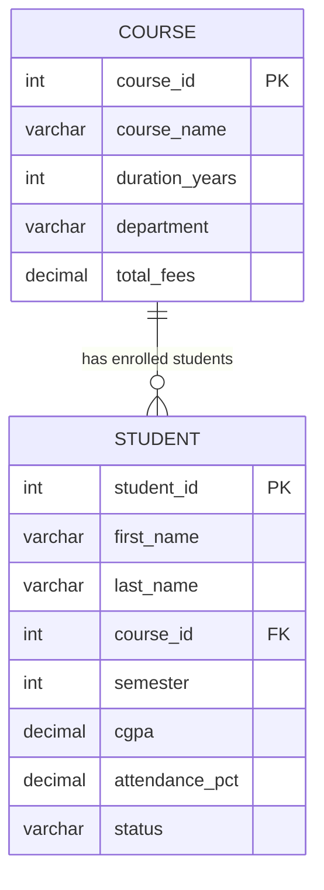
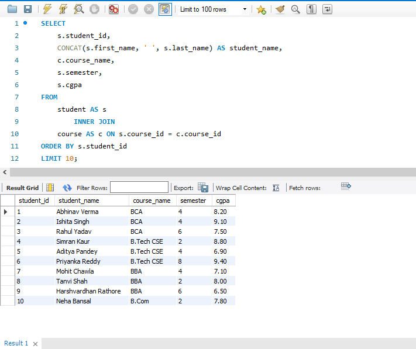
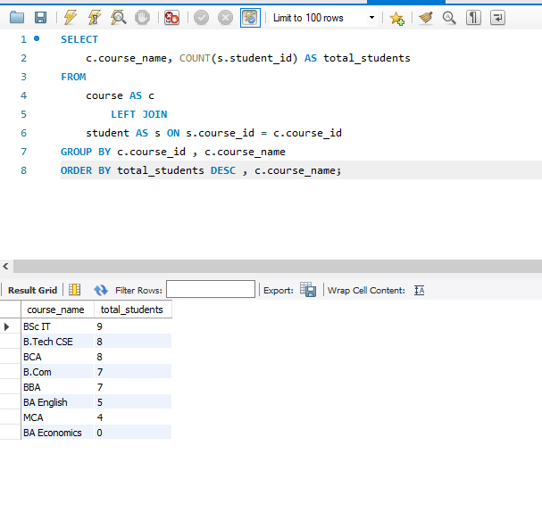
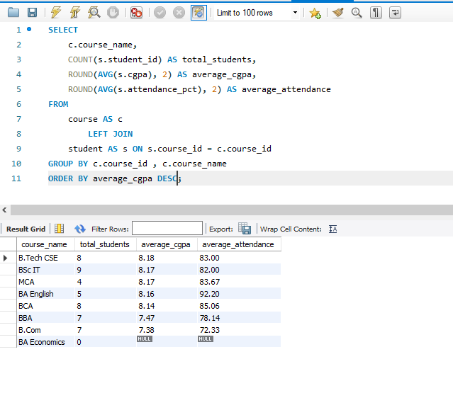
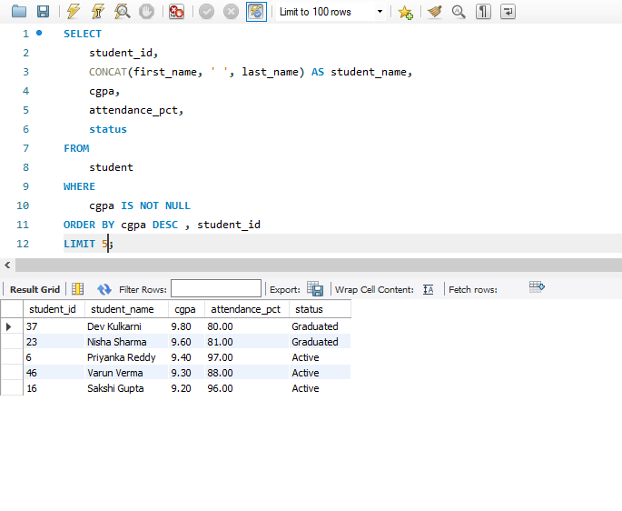
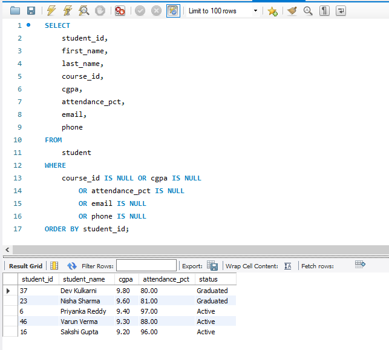

# College Student & Course SQL Analysis

A MySQL portfolio project by **Abhinav Verma** focused on relational data analysis, SQL problem-solving, and data-quality validation using a fictional college database.

## About Me

- **Name:** Abhinav Verma
- **Education:** BCA, 2nd Year — University of Lucknow
- **Career focus:** Data Analytics
- **Technical focus:** SQL, MySQL, data cleaning concepts, data validation, and analytical problem-solving
- **GitHub:** [Abhinav-analyzes9250](https://github.com/Abhinav-analyzes9250)
- **Email:** [av7562469@gmail.com](mailto:av7562469@gmail.com)

## Project Overview

This project explores a relational college database containing student and course information. It includes 60 SQL practice questions organised by difficulty, answer queries, and a separate validation script. The aim is to practise turning structured data into useful summaries while checking for missing or unusual values.

**Dataset notice:** All records are synthetic sample data created for learning and portfolio demonstration. They are not official university records.

## Project Objectives

- Retrieve, filter, sort, and summarise student and course data.
- Analyse student CGPA, attendance, semester, status, and course enrolment.
- Combine tables using joins and identify courses with no enrolled students.
- Answer multi-step questions using subqueries, CTEs, and window functions.
- Check missing values, row counts, ranges, and other data-quality conditions.
- Practise writing readable SQL queries that can support analytical reporting.

## Dataset Summary

| Item | Details |
|---|---|
| Database | `college_sql_practice` |
| Tables | `student`, `course` |
| Student records | 50 synthetic rows |
| Course records | 8 rows |
| Practice questions | 60, grouped by difficulty |
| Database engine | MySQL 8.0+ recommended |

The sample intentionally includes `NULL` values and a course with no enrolled students so that missing-data handling and outer joins can be practised.

## Database Relationship



A course can have zero or many student records. `student.course_id` references `course.course_id`; the relationship allows a student's course to be unknown (`NULL`).

## Repository Structure

| File | Purpose |
|---|---|
| `01_college_schema_and_data.sql` | Creates the database and tables, adds indexes and the foreign key, and inserts sample data. |
| `02_college_query_answers.sql` | Contains the SQL solutions organised by difficulty. |
| `03_college_data_validation.sql` | Runs data-quality checks for counts, missing values, ranges, and related conditions. |
| `PRACTICE_QUESTIONS.md` | Lists the 60 practice questions. |
| `README.md` | Project overview, setup steps, and documentation. |

## SQL Skills Demonstrated

- Basic querying: `SELECT`, `WHERE`, `DISTINCT`, `ORDER BY`, `LIMIT`
- Filtering: `BETWEEN`, `IN`, `LIKE`, `IS NULL`, `IS NOT NULL`
- Aggregation: `COUNT()`, `AVG()`, `SUM()`, `MIN()`, `MAX()`
- Grouped analysis: `GROUP BY`, `HAVING`, conditional logic with `CASE`
- Relationships: `INNER JOIN`, `LEFT JOIN`
- Advanced querying: subqueries, correlated subqueries, `EXISTS`, `UNION`, and CTEs
- Analytical functions: `RANK()` and `DENSE_RANK()`
- Data quality: missing-value checks, validation queries, and NULL-aware aggregation
- Database structure: primary keys, foreign keys, and indexes

## Getting Started

### Requirements

- MySQL Server 8.0 or later is recommended.
- MySQL Workbench or another MySQL client.
- The SQL files included in this repository.

### Run the project

1. Open MySQL Workbench and connect to your local MySQL server.
2. Open `01_college_schema_and_data.sql` and execute the full script.
3. Confirm that the script reports **50 student rows** and **8 course rows**.
4. Open and execute `03_college_data_validation.sql` to inspect the data-quality checks.
5. Open `PRACTICE_QUESTIONS.md` and then run the matching sections from `02_college_query_answers.sql`.
6. Execute one difficulty section at a time and inspect the result sets before moving on.

### Example query

```sql
USE college_sql_practice;

SELECT
    c.course_name,
    COUNT(s.student_id) AS student_count,
    ROUND(AVG(s.cgpa), 2) AS average_cgpa
FROM course AS c
LEFT JOIN student AS s
    ON c.course_id = s.course_id
GROUP BY c.course_id, c.course_name
ORDER BY student_count DESC;
```

This query summarises student count and average CGPA by course. The `LEFT JOIN` keeps courses with no matching students in the output, and `COUNT(s.student_id)` returns zero for those courses.

## Data Quality Notes

- `NULL` means a value is missing or unknown; it is not the same as zero.
- `COUNT(*)` counts rows, while `COUNT(column_name)` ignores `NULL` values in that column.
- Aggregate functions such as `AVG()` generally ignore `NULL` values.
- Use `IS NULL` or `IS NOT NULL` to check for missing values.
- A `LEFT JOIN` helps preserve rows from the left table even when no matching record exists in the right table.

## Important Safety Note Before Running SQL

The setup script drops and recreates the `student` and `course` tables **inside `college_sql_practice`** when rerun. Back up any changes you want to keep before running it again. Review statements before executing any query that changes data, such as `INSERT`, `UPDATE`, or `DELETE`.


## Project Screenshots

### 1. Student-Course JOIN
Combining student records with course information using INNER JOIN.



### 2. Course Enrollment Analysis
Counting students in each course using LEFT JOIN and GROUP BY.



### 3. Academic Performance Analysis
Comparing average CGPA and attendance across courses.



### 4. Top Five Students
Identifying the highest CGPA records using ORDER BY and LIMIT.



### 5. Data Quality Validation
Identifying missing values using IS NULL conditions.




## Learning Outcomes

This project provides hands-on practice with relational database querying, joins, aggregation, advanced SQL patterns, and data-quality checks. It is a learning project and does not claim production deployment or real institutional analysis.

## Contact

**Abhinav Verma**  
BCA, 2nd Year — University of Lucknow  
GitHub: [Abhinav-analyzes9250](https://github.com/Abhinav-analyzes9250)  
Email: [av7562469@gmail.com](mailto:av7562469@gmail.com)

---

*Built for learning and portfolio practice.*
